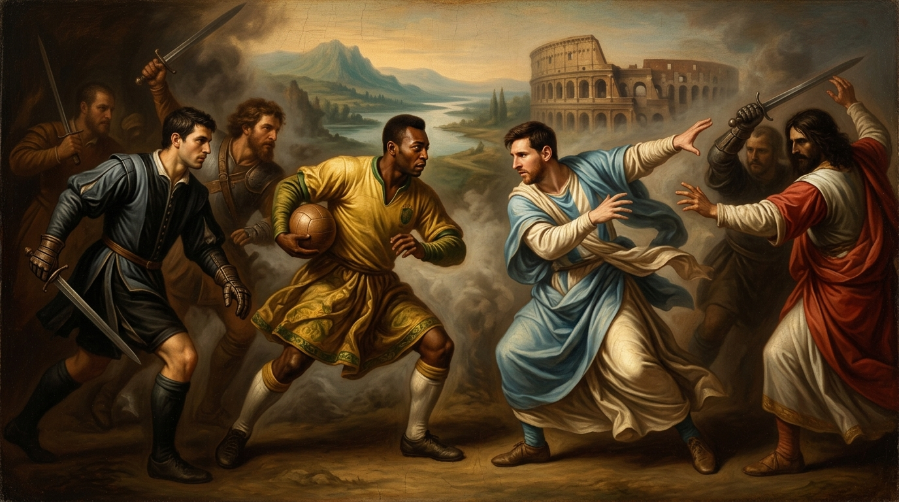
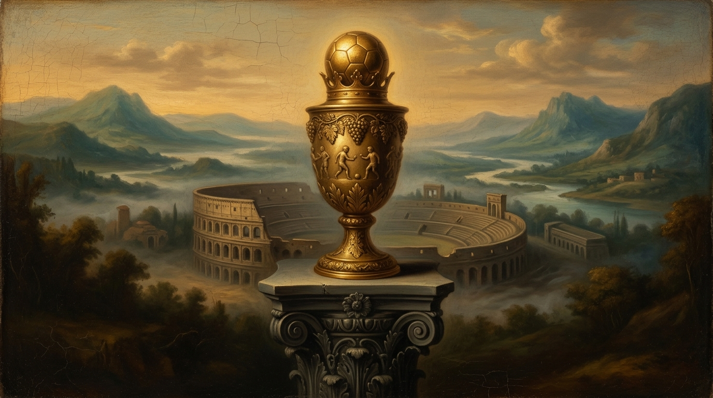
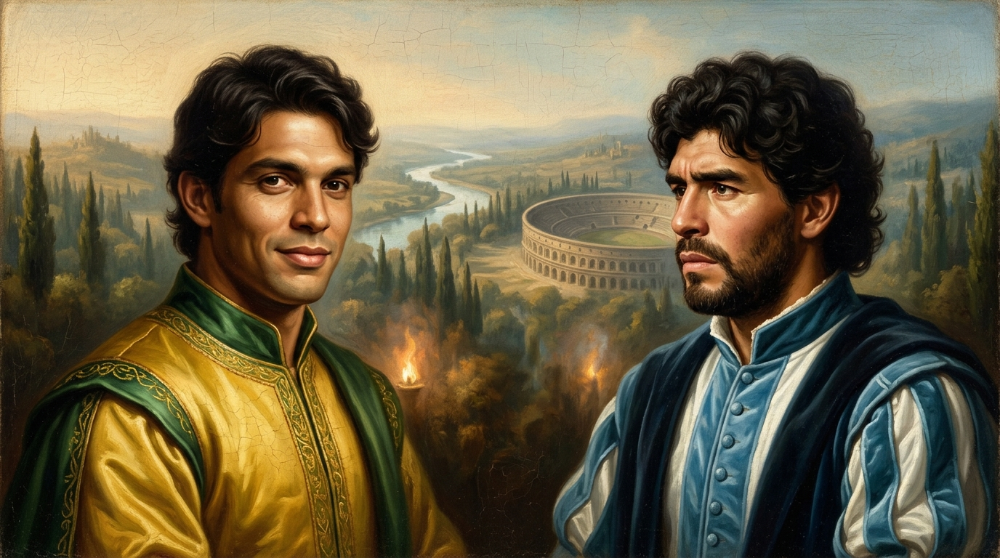
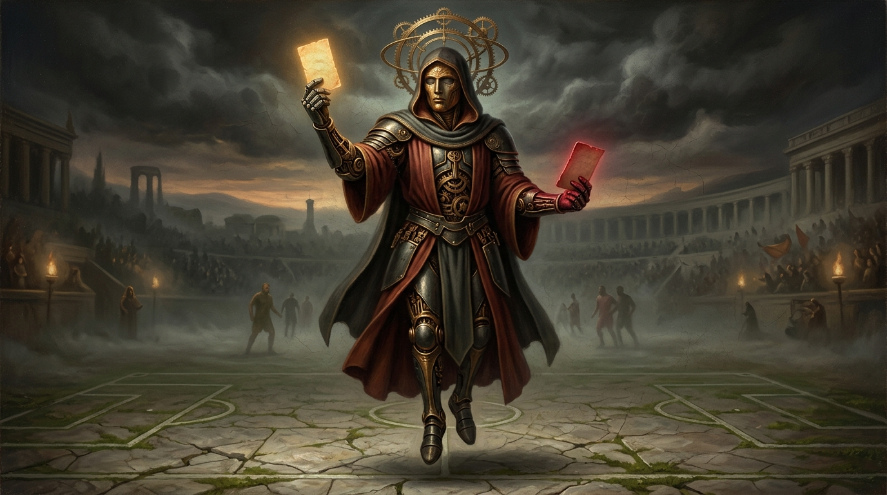

# ⚽ LA COPA ETERNA: SANGRE Y POTRERO
**Juego de Pelea 2.5D AAA de las Leyendas del Fútbol Sudamericano (CONMEBOL) — Edición Renacimiento *Sfumato***  
*Unreal Engine 5.4+ / 5.8.4 | C++20 Core | Punto Fijo Q32.32 Determinista | GGPO Rollback + EOS Crossplay | Shader `M_PP_SfumatoChiaroscuro` | Audiokinetic Wwise | WebLab 60 FPS*



---

## 🖼️ Dirección de Arte Dual: *Renacimiento Sfumato (Da Vinci)* & *Street-Ink AAA*
| Trofeo Oficial *La Copa Eterna* | Pantalla VS (*O Fenômeno* vs *La Pulga*) | Jefe Final: *V.A.R.-ZERO* |
| :---: | :---: | :---: |
|  |  |  |

---

## 🏆 Visión General y Pilares de Ingeniería ("Garra Charrúa & Jogo Bonito")
**LA COPA ETERNA: SANGRE Y POTRERO** es un motor y videojuego de lucha competitivo 2.5D a **60 FPS bloqueados (`16.66 ms/frame`)** desarrollado sobre **Unreal Engine 5.4+ / 5.8.4 (`EngineAssociation: "5.8"`)** y compatible con **Windows (Steam/Epic), PlayStation 5 y Xbox Series X|S**.

1. **Determinismo Matemático Absoluto (`FFixedPoint` Q32.32):**  
   Toda la física de combate, velocidades, gravedad y cajas de colisión AABB (`Pushbox`, `Hurtbox`, `Hitbox`, `ProjectileBox`) operan en enteros de 64 bits (`int64_t`) formato Q32.32, garantizando **0 desincronización** entre compiladores MSVC (PC/Xbox) y Clang (PS5).
2. **Esquema Competitivo de 5 Botones + Sistema Dual:**  
   - `LP` (Jab rápido 4f), `MP` (Cuerpo medio / Cabezazo), `HP` (Entrada dura), `SK` (Habilidad con Balón / Proyectil físico), `GB` (Gambeta / Parry de 2f).
   - **Barra de Hinchada (3 niveles)** para *EX Moves*, *Super Nivel 1* y *Grito Sagrado (Ultimate Nivel 3)*.
   - **Medidor de Tarjeta de Arbitraje** (Riesgo/Recompensa para golpes sucios y parries desesperados como *La Mano Salvadora*).
3. **Netcode GGPO Rollback + Epic Online Services (EOS):**  
   Puente UDP P2P directo a 60 Hz con paquetes ultraligeros de 12 bytes (`FGGPOUDPNetworkPacket`), Checksum Fletcher-32 en cada frame, Lobby para 16 jugadores (*"La Concentración"*) y repeticiones deterministas `.safreplay` (`RLE + Zlib < 50 KB`) con **Live Takeover ("Tomar el Control en Vivo")**.
4. **Arte Técnico "Street-Ink", Shaders HLSL y Chaos Cloth 5.4+:**  
   - Rim Light competitivo en 1 frame (Blanco = Invulnerable, Oro = Super Armor, Carmesí = Guard Crush, Verde = Falta de Aire `3,600m`).
   - Post-Proceso de 3 frames `"Impact Ink"` (Kuwahara + Sobel) en Counter Hits y Supers.
   - Simulación de camisetas holgadas de los años 90 con mapas de peso (`MaxDistance: 0.5 cm -> 12.0 cm`) y melenas en **Hair Cards** con cadenas de resortes.
5. **Audio Reactivo en Audiokinetic Wwise 2023.1+:**  
   Buses priorizados con **Sidechain Auto-Ducking (`-6.0 dB` / `-4.5 dB`, `HoldMs: 40ms / 80ms`)**, **19 archivos `.wav` reales (48 kHz 16-bit PCM mono)** que incluyen los **10 stems percusivos nacionales CONMEBOL** a su BPM exacto (`115` a `170 BPM`), atenuación acústica de altitud en La Paz (`3,600m`) y **Cabina de Relatores Sudamericanos en Vivo** con *Interrupt Stingers*.

---

## 🌎 Plantel Oficial de 16 Leyendas + Jefe Final (`17` Luchadores en `DT_SouthAmericaRoster.json`)


| # | Leyenda | Selección | Arquetipo | Vida (HP) | Dash | Movimiento Insignia |
| :-: | :--- | :--- | :--- | :---: | :---: | :--- |
| 1 | **O Fenômeno** | 🇧🇷 Brasil | Rushdown Explosivo | 10,000 | 15f | *Pedalada Mortal* (`236+LP`) |
| 2 | **O Bruxo** | 🇧🇷 Brasil | Trickster / Mix-up | 9,500 | 17f | *Elástica* (`41236+MP`) |
| 3 | **El Cañón** | 🇦🇷 Argentina | Powerhouse Shoto | 10,500 | 19f | *Bati-Cañonazo* (`236+SK`) |
| 4 | **La Pulga** | 🇦🇷 Argentina | Pixie / Footsies God | 9,000 | 14f | *Slalom Imposible* (`236+MP`) |
| 5 | **El Pibe** | 🇨🇴 Colombia | Setplay Zoner | 10,000 | 21f | *Pase Filtrado* (`236+SK`) |
| 6 | **El Loco** | 🇨🇴 Colombia | Counter-Acrobat | 10,200 | 18f | *El Escorpión* (`214+SK`) |
| 7 | **El Pistolero** | 🇺🇾 Uruguay | Hybrid Grappler / Brawler | 10,800 | 20f | *Presión Asfixiante* (`41236+LP`) |
| 8 | **El Matador** | 🇺🇾 Uruguay | Long-Range Hybrid | 10,000 | 18f | *Efecto Jabulani* (`236+SK`) |
| 9 | **Bam-Bam** | 🇨🇱 Chile | Air-Dominance / Divekick | 10,000 | 17f | *Cabezazo Suspendido* (`j.236+MP`) |
| 10 | **El Rey** | 🇨🇱 Chile | Berserker / Rekka Brawler | 10,400 | 16f | *Trancazo Real* (`236+LP`) |
| 11 | **El Bulldog** | 🇵🇾 Paraguay | Big-Body Grappler / Zoner | 11,500 | 23f | *Tiro Libre con Barrera* (`236+SK`) |
| 12 | **El Maestro** | 🇵🇪 Perú | Technical Footsies | 9,800 | 17f | *Tiro de Tres Dedos* (`236+SK~8`) |
| 13 | **El Tren Amazónico** | 🇪🇨 Ecuador | Speedster / Run-Cancel | 9,600 | 13f | *Expreso por la Banda* (`236+GB`) |
| 14 | **El Huracán Vinotinto** | 🇻🇪 Venezuela | Dead-Ball Sniper | 10,200 | 19f | *Zurda de Oro (Folha Seca)* (`236+SK`) |
| 15 | **El Diablo Andino** | 🇧🇴 Bolivia | Stamina Debuffer (`3,600m`) | 9,800 | 18f | *Balón Pesado (`3,600m`)* (`214+SK`) |
| 16 | **Le Général** | 🇫🇷 Francia (Inv.) | Tactical Stance / Counter | 10,000 | 17f | *Roulette de Marseille* (`236+MP`) |
| 👑 | **El Juez Supremo (V.A.R. - ZERO)** | 🤖 Sindicato Boss | Phase 1 Zoner / Phase 2 Rewind | 13,000 | 12f | *V.A.R. Rewind (-90f)* (`22+GB`) |

---

## 📂 Arquitectura del Repositorio

```text
├── SouthAmericaFighters.uproject       # Proyecto Unreal Engine 5.4+ / 5.8.4 (EngineAssociation: "5.8")
├── Config/                             # Configuración 60 FPS Determinista, Inputs y EOS Crossplay
├── Data/                               # DataTables JSON (17 Luchadores [16+Boss], 117 Movimientos Frame Data, 10 Estadios, Relatores)
├── Docs/GDD_LaCopaEterna.md            # Game Design Document (GDD) Maestro
├── Source/SouthAmericaFightersCore/    # Módulo C++20 Principal (24 archivos .h/.cpp)
│   ├── Public/ & Private/
│   │   ├── FixedPointTypes.h           # Librería Q32.32 (int64) y AABB deterministas
│   │   ├── FightingInputParser.*       # Ring Buffer de 60f, limpieza SOCD y parser FGC
│   │   ├── DeterministicFighterStateMachine.* # FSM a 60 Hz y serialización POD + Fletcher-32
│   │   ├── FighterCharacterPawn.*      # Pawn, Proyectil de Balón y Greyboxing AABB
│   │   ├── FightingMatchGameMode.*     # Árbitro Maestro de Partida 60 Hz y Wall Break
│   │   ├── BossAIController.*          # IA del Juez Supremo y V.A.R. Rewind (-90 frames)
│   │   ├── TrainingModeSubsystem.*     # Grabadora Multi-Slot (8 ranuras) y Reversals Frame 1
│   │   ├── EOSGGPONetworkBridge.*      # Puente UDP P2P EOS + GGPO Rollback
│   │   ├── CompetitiveReplayAndAntiCheat.* # Compresor .safreplay (<50KB), Anti-Cheat y Glicko-2
│   │   ├── FighterVisualFeedbackComponent.* # Hitstop, Hitshake y Chaos Cloth Reset
│   │   ├── FightingNiagaraVFXDirector.* # Spawner determinista de partículas Niagara
│   │   ├── FighterAnimInstance.*       # Stepped Animation 60 FPS y Control Rig Smear (1.25x)
│   │   ├── FightingCameraAndReplayDirector.* # Cámara 2.5D Spring-Damper y Live Takeover
│   │   ├── WwiseCombatAudioDirector.*  # Director acústico Wwise, RTPCs y Relatores
│   │   ├── CombatHUDAndHapticsSubsystem.* # HUD Zero-GC y Háptica DualSense / Xbox Impulse
│   │   └── FightingUIManagerSubsystem.* # Pila de 4 Capas CommonUI y Dual-Cursor
├── Shaders/                            # Shaders HLSL/USH (Rim Light, Impact Ink, Skin Pores, Stadium FX, HUD SDF)
├── Assets/
│   ├── Models3D/                       # 17 Luchadores Skinned (.glb), Balón 32 Paneles (.glb/.obj) y 10 Estadios (.glb)
│   ├── TexturesPBR/                    # 18 Texturas PBR (.png 1024x1024): Albedos 90s, Normals Jacquard/Poros y ORM
│   ├── UI/SVG/                         # Atlas Vectorial Maestro (Glifos PS5/Xbox/FGC y 10 Escudos CONMEBOL)
│   └── ConceptArt/                     # Key Art promocional y lámina de retratos
├── Audio/
│   ├── WwiseProject/                   # Manifiesto y Master-Mixer Hierarchy (.wwu) con Sidechain Auto-Ducking
│   └── GeneratedStems/                 # 19 archivos .wav reales (48kHz 16-bit PCM): 8 SFX, 10 Hinchadas CONMEBOL y 1 Háptica
├── Backend/                            # Servidor eSports en Go, PostgreSQL (schema.sql), Dockerfile y docker-compose.yml
├── Scripts/                            # Generadores 3D/PBR/WAV, importer UE5/Blender y Stress Test Headless GGPO
└── WebLab/                             # Suite Interactiva HTML5/Canvas a 60 FPS (7 Pestañas + Modo Versus 1v1 Jugable)
```

---

## 🚀 Cómo Ejecutar y Empaquetar el Juego

### 1. Lanzador Rápido WebLab 60 FPS (Windows 1-Clic)
Haz doble clic en **`start-game.bat`** o ejecuta en consola:

```bash
python -m http.server 8080
# Abre http://localhost:8080/WebLab/main-menu.html
```

- **[Menú Principal AAA](WebLab/main-menu.html):** Pantalla de título *Renacimiento Sfumato*, Pantalla VS animada y selector de estilo en vivo.
- **[Selección de Leyendas 16+1 y 10 Estadios](WebLab/character-select.html):** Paneles bilaterales P1 vs P2, estadísticas y vista previa de escenarios.
- **[Modo Torneo "La Copa Eterna"](WebLab/tournament.html):** Llave determinista de 5 rondas (`Xorshift32`) con desbloqueo secreto de Fase 2 de `V.A.R.-ZERO`.
- **[Galería de Arte AAA](WebLab/art-gallery.html):** Exposición de los 9 lienzos *Renacimiento Sfumato*, 3 obras *Street-Ink* y Atlas Vectorial SVG.
- **[Command Center & Modo Versus 1v1 (7 Pestañas)](WebLab/index.html):** Frame Data, Kernel Q32.32, Potrero/GGPO, Shaders/Wwise, Arbitraje eSports, **TAB 06 Versus 1v1 (Luchadores Articulados + Gamepad PS5/Xbox + Input Display FGC + Victoria K.O.)** y **TAB 07 Visor 3D (17 Luchadores Animados + 10 Estadios CONMEBOL `.glb`)**.

### 2. Importación Automática en Unreal Engine 5.4+ / 5.8.4
1. Abre **`SouthAmericaFighters.uproject`** en **Unreal Engine 5.4+ / 5.8.4** (configurado con `EngineAssociation: "5.8"`, `PythonScriptPlugin` e `Interchange` habilitados).
2. Ejecuta la auditoría local previa o corre el pipeline dentro del editor UE:
```bash
python Scripts/ue5_auto_import_pipeline.py --dry-run
```

### 3. Backend eSports Go (Tests & Docker)
```bash
cd Backend
go test -v ./...
docker compose up --build
```

### 4. Stress Test Determinista GGPO (18,000 Frames / 0 Desyncs)
```bash
python Scripts/headless_desync_stress_test.py --matches 15 --frames 1200 --packet-loss 0.25 --max-rollback 8
```
