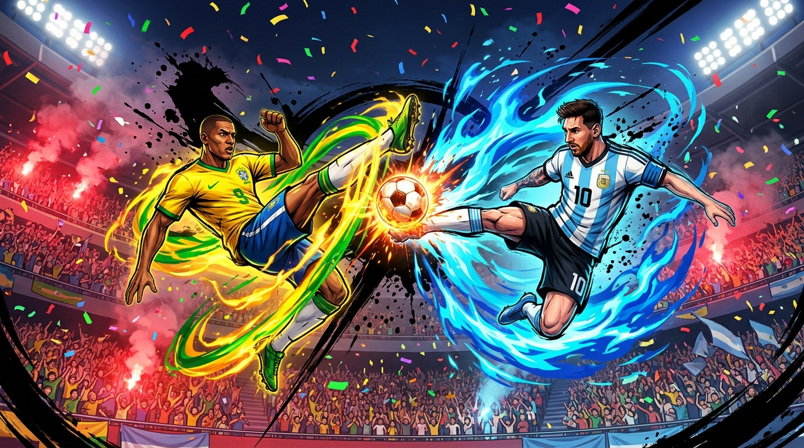
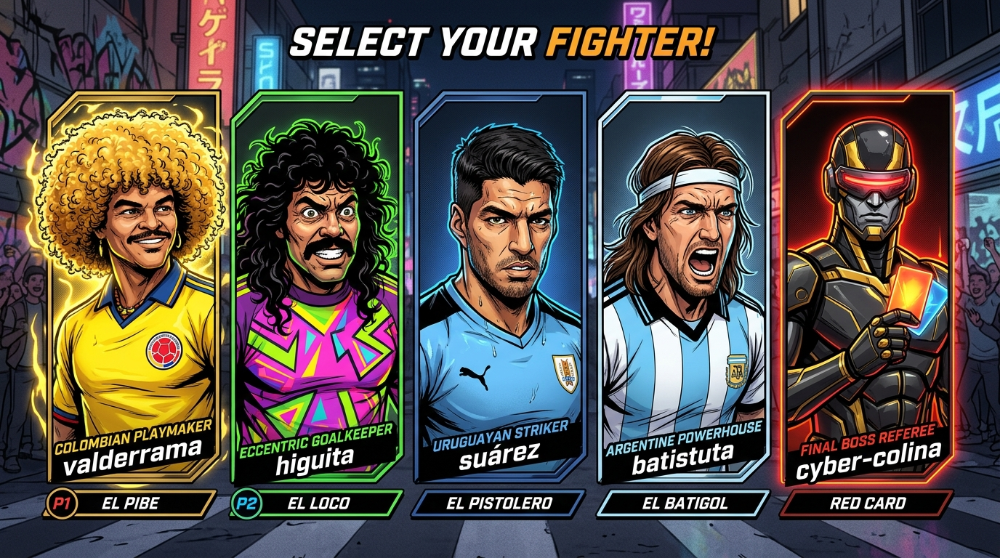

# ⚽ LA COPA ETERNA: SANGRE Y POTRERO
**Juego de Pelea 2.5D AAA de las Leyendas del Fútbol Sudamericano (CONMEBOL)**  
*Unreal Engine 5.4+ | C++20 Core | Punto Fijo Q32.32 Determinista | GGPO Rollback + EOS Crossplay | Audiokinetic Wwise | WebLab 60 FPS*



---

## 🏆 Visión General y Pilares de Ingeniería ("Garra Charrúa & Jogo Bonito")
**LA COPA ETERNA: SANGRE Y POTRERO** es un motor y videojuego de lucha competitivo 2.5D a **60 FPS bloqueados (`16.66 ms/frame`)** compatible con **Windows (Steam/Epic), PlayStation 5 y Xbox Series X|S**.

1. **Determinismo Matemático Absoluto (`FFixedPoint` Q32.32):**  
   Toda la física de combate, velocidades, gravedad y cajas de colisión AABB (`Pushbox`, `Hurtbox`, `Hitbox`, `ProjectileBox`) operan en enteros de 64 bits (`int64_t`) formato Q32.32, garantizando **0 desincronización** entre compiladores MSVC (PC/Xbox) y Clang (PS5).
2. **Esquema Competitivo de 5 Botones + Sistema Dual:**  
   - `LP` (Jab rápido 4f), `MP` (Cuerpo medio / Cabezazo), `HP` (Entrada dura), `SK` (Habilidad con Balón / Proyectil físico), `GB` (Gambeta / Parry de 2f).
   - **Barra de Hinchada (3 niveles)** para *EX Moves*, *Super Nivel 1* y *Grito Sagrado (Ultimate Nivel 3)*.
   - **Medidor de Tarjeta de Arbitraje** (Riesgo/Recompensa para golpes sucios y parries desesperados como *La Mano Salvadora*).
3. **Netcode GGPO Rollback + Epic Online Services (EOS):**  
   Puente UDP P2P directo a 60 Hz con paquetes ultraligeros de 12 bytes (`FGGPOUDPNetworkPacket`), Checksum Fletcher-32 en cada frame, Lobby para 16 jugadores (*"La Concentración"*) y repeticiones deterministas `.safreplay` (`RLE + Zlib < 50 KB`) con **Live Takeover ("Tomar el Control en Vivo")**.
4. **Arte Técnico "Street-Ink", Shaders HLSL y Chaos Cloth 5.4:**  
   - Rim Light competitivo en 1 frame (Blanco = Invulnerable, Oro = Super Armor, Carmesí = Guard Crush, Verde = Falta de Aire 3600m).
   - Post-Proceso de 3 frames `"Impact Ink"` (Kuwahara + Sobel) en Counter Hits y Supers.
   - Simulación de camisetas holgadas de los años 90 con mapas de peso (`MaxDistance: 0.5 cm -> 12.0 cm`) y melenas en **Hair Cards** con cadenas de resortes.
5. **Audio Reactivo en Audiokinetic Wwise 2023.1+:**  
   Buses priorizados con **Sidechain Auto-Ducking (`-6.0 dB`)**, cánticos dinámicos de las 10 selecciones CONMEBOL (`RTPC_Crowd_Momentum` y `RTPC_Match_Excitement`) y **Cabina de Relatores Sudamericanos en Vivo** con *Interrupt Stingers*.

---

## 🌎 Plantel Oficial de 16 Luchadores + Jefe Final



| # | Leyenda | Selección | Arquetipo | Vida (HP) | Dash | Movimiento Insignia |
| :-: | :--- | :--- | :--- | :---: | :---: | :--- |
| 1 | **O Fenômeno** | 🇧🇷 Brasil | Rushdown Explosivo | 10,000 | 15f | *Pedalada Mortal* (`236+LP/MP/HP`) |
| 2 | **O Bruxo** | 🇧🇷 Brasil | Trickster / Mix-up | 9,500 | 17f | *Elástica & No-Look* (`41236+MP`) |
| 3 | **El Cañón** | 🇦🇷 Argentina | Powerhouse Shoto | 10,500 | 19f | *Bati-Cañonazo* (`236+[SK]`) |
| 4 | **La Pulga** | 🇦🇷 Argentina | Pixie / Footsies God | 9,000 | 14f | *Slalom Imposible* (`236+LP/MP/HP`) |
| 5 | **El Pibe** | 🇨🇴 Colombia | Setplay Zoner | 10,000 | 21f | *Pase Filtrado* (`236+SK`) |
| 6 | **El Loco** | 🇨🇴 Colombia | Counter-Acrobat | 10,200 | 18f | *El Escorpión* (`214+SK`) |
| 7 | **El Pistolero** | 🇺🇾 Uruguay | Hybrid Grappler / Brawler | 10,800 | 20f | *Presión Asfixiante* (`41236+LP`) |
| 8 | **El Matador** | 🇺🇾 Uruguay | Long-Range Hybrid | 10,000 | 18f | *Efecto Jabulani* (`236+SK~214+SK`) |
| 9 | **Bam-Bam** | 🇨🇱 Chile | Air-Dominance / Divekick | 10,000 | 17f | *Cabezazo Suspendido* (`j.236+HP`) |
| 10 | **El Rey** | 🇨🇱 Chile | Berserker / Rekka Brawler | 10,400 | 16f | *Trancazo Real* (`236+LP/MP/HP x3`) |
| 11 | **El Bulldog** | 🇵🇾 Paraguay | Big-Body Grappler / Zoner | 11,500 | 23f | *Tiro Libre con Barrera* (`236+SK`) |
| 12 | **El Maestro** | 🇵🇪 Perú | Technical Footsies | 9,800 | 17f | *Tiro de Tres Dedos* (`236+SK~8/2`) |
| 13 | **El Tren Amazónico** | 🇪🇨 Ecuador | Speedster / Run-Cancel | 9,600 | 13f | *Expreso por la Banda* (`236+GB`) |
| 14 | **El Huracán Vinotinto** | 🇻🇪 Venezuela | Dead-Ball Sniper | 10,200 | 19f | *Zurda Folha Seca* (`236+SK`) |
| 15 | **El Diablo Andino** | 🇧🇴 Bolivia | Stamina Debuffer (3600m) | 9,800 | 18f | *Balón Pesado 3600m* (`214+SK`) |
| 16 | **Le Général** | 🇫🇷 Francia (Inv.) | Tactical Stance / Counter | 10,000 | 17f | *Roulette de Marseille* (`236+MP`) |
| 👑 | **El Juez Supremo (V.A.R. - ZERO)** | 🤖 Sindicato Boss | Phase 1 Zoner / Phase 2 Rewind | 13,000 | 12f | *Línea de Offside & V.A.R. Rewind (-90f)* |

---

## 📂 Arquitectura del Repositorio

```text
├── SouthAmericaFighters.uproject       # Proyecto Unreal Engine 5.4+
├── Config/                             # Configuración 60 FPS Determinista, Inputs y EOS Crossplay
├── Data/                               # DataTables JSON (16 Leyendas, 111 Movimientos Frame Data, 10 Estadios, Relatores)
├── Docs/GDD_LaCopaEterna.md            # Game Design Document (GDD) Maestro
├── Source/SouthAmericaFightersCore/    # Módulo C++20 Principal (24 archivos .h/.cpp)
│   ├── Public/ & Private/
│   │   ├── FixedPointTypes.h           # Librería Q32.32 (int64) y AABB deterministas
│   │   ├── FightingInputParser.*       # Ring Buffer de 60f, limpieza SOCD y parser FGC
│   │   ├── DeterministicFighterStateMachine.* # FSM a 60 Hz y serialización POD + Fletcher-32
│   │   ├── FighterCharacterPawn.*      # Pawn, Proyectil de Balón y Greyboxing AABB
│   │   ├── FightingMatchGameMode.*     # Árbitro Maestro de Partida 60 Hz y Wall Break
│   │   ├── BossAIController.*          # IA del Juez Supremo y V.A.R. Rewind (-90 frames)
│   │   ├── TrainingModeSubsystem.*     # Grabadora Multi-Slot (8 ranuras) y Reversals Frame 1
│   │   ├── EOSGGPONetworkBridge.*      # Puente UDP P2P EOS + GGPO Rollback
│   │   ├── CompetitiveReplayAndAntiCheat.* # Compresor .safreplay (<50KB), Anti-Cheat y Glicko-2
│   │   ├── FighterVisualFeedbackComponent.* # Hitstop, Hitshake y Chaos Cloth Reset
│   │   ├── FightingNiagaraVFXDirector.* # Spawner determinista de partículas Niagara
│   │   ├── FighterAnimInstance.*       # Stepped Animation 60 FPS y Control Rig Smear (1.25x)
│   │   ├── FightingCameraAndReplayDirector.* # Cámara 2.5D Spring-Damper y Live Takeover
│   │   ├── WwiseCombatAudioDirector.*  # Director acústico Wwise, RTPCs y Relatores
│   │   ├── CombatHUDAndHapticsSubsystem.* # HUD Zero-GC y Háptica DualSense / Xbox Impulse
│   │   └── FightingUIManagerSubsystem.* # Pila de 4 Capas CommonUI y Dual-Cursor
├── Shaders/                            # Shaders HLSL/USH (Rim Light, Impact Ink, Skin Pores, Stadium FX, HUD SDF)
├── Assets/
│   ├── Models3D/                       # 17 Luchadores Skinned (.glb), Balón 32 Paneles (.glb/.obj) y Estadio (.glb)
│   ├── TexturesPBR/                    # 18 Texturas PBR (.png 1024x1024): Albedos 90s, Normals Jacquard/Poros y ORM
│   ├── UI/SVG/                         # Atlas Vectorial Maestro (Glifos PS5/Xbox/FGC y 10 Escudos CONMEBOL)
│   └── ConceptArt/                     # Key Art promocional y lámina de retratos
├── Audio/
│   ├── WwiseProject/                   # Manifiesto y Master-Mixer Hierarchy (.wwu) con Sidechain Auto-Ducking
│   └── GeneratedStems/                 # 13 archivos .wav reales (48kHz 16-bit): Golpes, Silbato, Hinchadas y Háptica
├── Backend/                            # Servidor eSports en Go, PostgreSQL (schema.sql), Dockerfile y docker-compose.yml
├── Scripts/                            # Generadores 3D/PBR/WAV, importer UE5/Blender y Stress Test Headless GGPO
└── WebLab/                             # Suite Interactiva HTML5/Canvas a 60 FPS (7 Pestañas + Modo Versus 1v1 Jugable)
```

---

## 🚀 Cómo Ejecutar el Laboratorio Interactivo y Modo Versus 1v1 Jugable (`WebLab`)

Puedes abrir directamente `WebLab/index.html` en cualquier navegador moderno o iniciar un servidor local:

```bash
python -m http.server 8080
# Abre http://localhost:8080/WebLab/index.html
```

- **Pestaña 01:** Visor Técnico de Frame Data, Hitboxes/Hurtboxes y Roster CONMEBOL.
- **Pestaña 02:** Depurador de Kernel Determinista (`Q32.32`, Ring Buffer 60f y Checksum Fletcher-32).
- **Pestaña 03:** El Potrero de Pruebas (Dummy Multi-Slot), Monitor GGPO, Wall Break, Live Takeover y V.A.R. Rewind.
- **Pestaña 04:** Laboratorio de Shaders (Hitstop, Impact Ink, Rim Light), Glifos CommonUI, Curvas DualSense y Consola Wwise.
- **Pestaña 05:** Centro de Arbitraje eSports (Auditor Anti-Cheat, Compresor `.safreplay` y Calculadora Glicko-2).
- **Pestaña 06:** **⚽ Modo Versus 1v1 Jugable en Tiempo Real (60 FPS)** con sintes de hinchada y relator en vivo.
- **Pestaña 07:** **🧊 Estudio 3D Interactivo Orbital 360°** (Shaded PBR, Esqueleto de 186 huesos, Mapa de Calor Chaos Cloth y Smear Frames).
